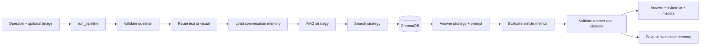

# Financial Document Copilot

A small college-project demo. It loads 10 documents from `sujet-ai/Sujet-Finance-QA-Vision-100k`, retrieves matching dataset QA pairs, and returns their answer with a document citation. This is a working no-LLM baseline; strategies can be replaced without changing the pipeline.

Dataset source: [Sujet-Finance-QA-Vision-100k](https://huggingface.co/datasets/sujet-ai/Sujet-Finance-QA-Vision-100k).

## Setup and run

```bash
uv sync
uv run python -m scripts.download_sample
uv run streamlit run app.py
```

The 10-record sample and images are included in `data/sample/`; the command verifies they are present. To fetch a fresh bounded sample, use `TMPDIR=/tmp uv run python -m scripts.download_sample --refresh`. The refresh streams only 10 rows; it does not download the full dataset.

Run tests with `uv run python -m unittest discover -s tests -v`. Dense search uses ChromaDB with a small deterministic hashing encoder, so the baseline does not need to download an embedding model. Set `CHROMA_PATH` to change the local vector-store directory. For an optional Sentence Transformers encoder, install the extra with `uv sync --extra embeddings`.

## End-to-end flow



The main code is intentionally small:

- `src/pipeline.py` — the single `run_pipeline()` function and the `PipelineStrategies` injection point.
- `src/strategies.py` — interchangeable retrieval, RAG, prompt, answer, memory, and evaluation strategies.
- `src/data_loader.py` — loads the first 10 dataset rows, parses QA JSON, and saves images plus a local manifest.
- `app.py` — small Streamlit interface calling the same pipeline.
- `scripts/download_sample.py` — explicit, bounded dataset download.

## Switching strategies

Pass a different strategy in `PipelineStrategies`; no pipeline edits are needed:

```python
from src.pipeline import PipelineStrategies, run_pipeline
from src.strategies import KeywordSearch, SimpleRAG, FewShotPrompt, CriticAnswer

choices = PipelineStrategies(
    rag=SimpleRAG(KeywordSearch()),  # or AutoRAG / VisualRAG / CombinedRAG / MultiStepRAG
    prompt=FewShotPrompt(),         # or SimplePrompt / ZeroShotPrompt / DecompositionPrompt
    answerer=CriticAnswer(),
)
result = run_pipeline("What is the invoice date?", documents, strategies=choices)
```

`ChromaSearch` and `KeywordSearch` are the included search choices. Chroma can use `WholeDocumentChunking`, `FixedSizeChunking`, or `ParagraphChunking`. `HashingEmbedder` is the lightweight default; `SentenceTransformerEmbedder` can be injected for learned embeddings. `DatasetAnswer` uses answers present in the dataset rather than inventing answers with an unconfigured LLM. `LLMAnswer` accepts a model callable; `CriticAnswer` and `VotingAnswer` provide simple single/critic/voting patterns. `SimpleEvaluator`, `JudgeEvaluator`, and `VotingEvaluator` are small extension points for comparing evaluation strategies. `VisualRAG` requires an injected vision function; no fake vision result is produced.

This prototype is for document Q&A demonstrations only. It does not provide personalized financial advice or execute financial actions.
