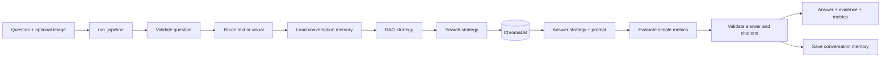

# Financial Document Copilot

A small college-project demo. It loads 10 documents from `sujet-ai/Sujet-Finance-QA-Vision-100k`, retrieves matching dataset QA pairs, and returns their answer with a document citation. This is a working no-LLM baseline; strategies can be replaced without changing the pipeline.
Strategy extension uses simple class inheritance (`BaseClass -> CustomClass`) via Python `abc` base classes, not `Protocol`.

Dataset source: [Sujet-Finance-QA-Vision-100k](https://huggingface.co/datasets/sujet-ai/Sujet-Finance-QA-Vision-100k).

## Setup and run

```bash
uv sync
cp .env.example .env
uv run python -m scripts.download_sample
uv run uvicorn src.api.main:app --reload
```

The 10-record sample and images are included in `data/sample/`; the command verifies they are present. To fetch a fresh bounded sample, use `TMPDIR=/tmp uv run python -m scripts.download_sample --refresh`. The refresh streams only 10 rows; it does not download the full dataset.

Open:

- `http://127.0.0.1:8000/` as the **initial home page** (navigator with all links)
- `http://127.0.0.1:8000/rag` for **Page 1** (RAG/chunking/embedding/vector-db setup + indexing)
- `http://127.0.0.1:8000/query` for **Page 2** (query UI with chunk/image/score/critique details)
- `http://127.0.0.1:8000/dashboard` for **Page 3** (trace dashboard with real query executions)
- `http://127.0.0.1:8000/evaluation` for **Page 4** (evaluation metrics + per-datapoint observations + failure taxonomy + image links)

Run tests with `uv run python -m unittest discover -s tests -v`. Dense search uses ChromaDB with a small deterministic hashing encoder, so the baseline does not need to download an embedding model. Set `CHROMA_PATH` to change the local vector-store directory. For an optional Sentence Transformers encoder, install the extra with `uv sync --extra embeddings`.

## Strategy config (from `.env`)

The app now builds strategies from config automatically. Set these keys in `.env`:

- `SEARCH_STRATEGY`: `chroma` or `keyword`
- `RAG_STRATEGY`: `auto`, `simple`, `multistep`, `agentic`, `combined`, `visual`
- `PROMPT_STRATEGY`: `simple`, `zero_shot`, `few_shot`, `decomposition`
- `ANSWER_STRATEGY`: `dataset`, `critic`, `voting`, `llm`
- `MEMORY_STRATEGY`: `conversation`, `none`
- `EVALUATOR_STRATEGY`: `simple`, `voting`
- `CHUNKING_STRATEGY`: `whole`, `fixed`, `paragraph`
- `EMBEDDER_STRATEGY`: `hashing`, `sentence_transformer`
- `METRICS_DB_PATH`: SQLite path for dashboard rows

## API endpoints

- `GET /api/health` — service status + loaded document count
- `GET /api/config` — active strategy configuration
- `POST /api/query` — run end-to-end pipeline and store metrics
- `GET /api/metrics` — list recent run rows for dashboard comparison
- `POST /api/metrics` — insert manual comparison rows
- `GET /api/traces` — query trace rows with retrieved chunks, scores, citations, critiques, and steps
- `POST /api/rag/setup` — configure RAG/chunking/embedder and index selected dataset subset
- `GET /api/rag/setups` — setup history rows
- `POST /api/evaluate` — evaluate on subset and save summary + per-datapoint observations
- `GET /api/evaluations` — evaluation run summaries
- `GET /api/evaluations/{id}` — observation rows for one evaluation run

For offline/classroom demos, `POST /api/rag/setup` supports `use_saved_sample=true` to skip downloading and index the already saved local sample.

## End-to-end flow



The main code is intentionally small and split by logical folders:

- `src/pipeline/runner.py` — the single `run_pipeline()` function and the `PipelineStrategies` injection point.
- `src/strategies/` — interchangeable retrieval, RAG, prompt, answer, memory, and evaluation classes.
- `src/data/loader.py` — loads the first 10 dataset rows, parses QA JSON, and saves images plus a local manifest.
- `src/models/records.py` — shared dataclasses (`Document`, `QAPair`, `Evidence`).
- `app.py` — small Streamlit interface calling the same pipeline.
- `scripts/download_sample.py` — explicit, bounded dataset download.

## Switching strategies programmatically

Config is the default path. For experiments, you can still override in code:

```python
from src.pipeline import PipelineStrategies, run_pipeline
from src.strategies import KeywordSearch, SimpleRAG, FewShotPrompt, CriticAnswer

choices = PipelineStrategies(
    rag=SimpleRAG(KeywordSearch()),  # or AutoRAG / VisualRAG / CombinedRAG / MultiStepRAG
    prompt=FewShotPrompt(),         # or SimplePrompt / ZeroShotPrompt / DecompositionPrompt
    answerer=CriticAnswer(),
)
result = run_pipeline("What is the invoice date?", documents, strategies=choices)
```

`ChromaSearch` and `KeywordSearch` are the included search choices. Chroma can use `WholeDocumentChunking`, `FixedSizeChunking`, or `ParagraphChunking`. `HashingEmbedder` is the lightweight default; `SentenceTransformerEmbedder` can be injected for learned embeddings. `DatasetAnswer` uses answers present in the dataset rather than inventing answers with an unconfigured LLM. `LLMAnswer` accepts a model callable; `CriticAnswer` and `VotingAnswer` provide simple single/critic/voting patterns. `SimpleEvaluator`, `JudgeEvaluator`, and `VotingEvaluator` are small extension points for comparing evaluation strategies. `VisualRAG` requires an injected vision function; no fake vision result is produced.

This prototype is for document Q&A demonstrations only. It does not provide personalized financial advice or execute financial actions.
